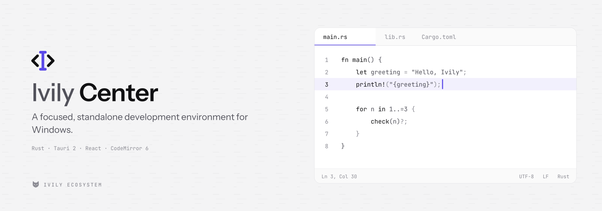
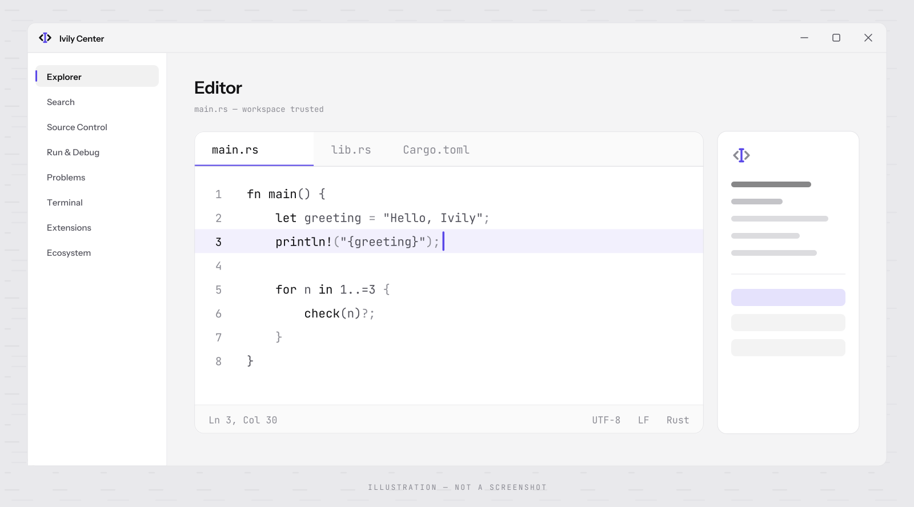
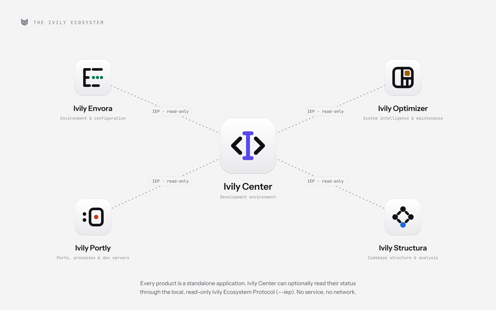

<p align="center">
  <picture>
    <source media="(prefers-color-scheme: dark)" srcset="assets/brand/banners/ivily-center-readme-banner-dark.svg">
    
  </picture>
</p>

<p align="center">
  <a href="#install">Install</a> ·
  <a href="#build-from-source">Build</a> ·
  <a href="#documentation">Documentation</a> ·
  <a href="DEVELOPMENT_STATUS.md">Status</a> ·
  <a href="#the-ivily-ecosystem">Ecosystem</a>
</p>

<p align="center">
  <a href="https://github.com/efecrtgl/ivily-center-main/actions/workflows/ci.yml"></a>
  <a href="LICENSE"></a>
</p>

**Ivily Center** is an open-source, Windows-first development environment built with Rust, Tauri 2, React and CodeMirror 6. It is a complete IDE on its own — workspaces, editor, language servers, terminal, Git, tasks and debugging — and, optionally, the hub of the Ivily ecosystem.

> [!NOTE]
> **Status — 0.1.0, pre-release.** All 26 planned phases are implemented and tested (149 Rust + 185 frontend tests). Tag `v0.1.0` exists, but **no GitHub release has been published yet**: publication waits for the updater signing secret. Until then, build from source. What has and has not been verified on real hardware is listed in [DEVELOPMENT_STATUS.md](DEVELOPMENT_STATUS.md).

<p align="center">
  <picture>
    <source media="(prefers-color-scheme: dark)" srcset="assets/brand/illustrations/ivily-center-product-visual-dark.svg">
    
  </picture>
  <br><sub><i>Illustration, not a screenshot.</i></sub>
</p>

## Principles

<table>
<tr>
<td width="25%" valign="top"><b>Standalone</b><br><sub>Every IDE feature works without any other Ivily app installed.</sub></td>
<td width="25%" valign="top"><b>Untrusted by default</b><br><sub>Nothing from a workspace runs until you trust it — and tasks and launch configurations still need approval of their exact command.</sub></td>
<td width="25%" valign="top"><b>No silent destruction</b><br><sub>No silent installs, elevation or telemetry. Deletes go to the Recycle Bin; saves never overwrite external changes.</sub></td>
<td width="25%" valign="top"><b>Honest</b><br><sub>Features are documented once they exist; unverified parts are listed as such.</sub></td>
</tr>
</table>

## Features

| Area | Highlights |
|---|---|
| **Workspaces** | Folders and multi-root `*.ivily-workspace` files, launcher with recents/favorites/discovery, per-workspace settings and sessions, crash recovery, **Workspace Trust** per folder and capability, multiple windows |
| **Explorer** | Lazy tree with Git decorations, `.gitignore`/excludes, file watcher, create/rename/move/copy, Recycle Bin deletes, properties |
| **Editor** | CodeMirror 6: tabs, split groups, preview tabs, hot exit (drafts), encodings and line endings, large files, conflict-safe saves, bookmarks, Markdown/HTML preview |
| **Languages** | 60+ languages with honest support tiers, toolchain detection (without installing anything), **LSP** for 23 known servers — completion, hover, diagnostics, navigation, rename, formatting |
| **Terminal** | ConPTY terminals with PowerShell / CMD / Git Bash / WSL profiles, tabs and splits, search, links |
| **Git** | Status, staging, commits/amend, branches, history, diffs, stashes, tags, remotes, merge/rebase/cherry-pick/revert, conflict resolution — never forced |
| **Search** | Workspace search/replace (ripgrep libraries), Quick Open (<kbd>Ctrl</kbd>+<kbd>P</kbd>), Command Palette (<kbd>Ctrl</kbd>+<kbd>Shift</kbd>+<kbd>P</kbd>), symbols, go to line, keyboard-shortcut editor |
| **Tasks** | `.ivily` / `.vscode` tasks, npm scripts, Cargo; approval of the exact command on first run; dependencies; problem matchers |
| **Debugging** | Debug Adapter Protocol client (debugpy, lldb-dap, netcoredbg or any configured adapter): breakpoints, stepping, call stack, variables, debug console |
| **Problems & Output** | Diagnostics and task problems in one panel; output channels with secret redaction and export |
| **Customization** | Six themes (modern, pixel, retro, glass), user themes and icon packs, settings import/export, declarative **extensions** (themes, icon packs, snippets, shortcuts, file associations — no code) |
| **Ivily ecosystem** | Read-only **Ivily Ecosystem Protocol** client and dashboard; Center answers `--iep describe` itself |
| **Maintenance** | Signed updates from GitHub Releases (only after confirmation), verified backups of app data with staged restore |
| **Accessibility** | Every command reachable by keyboard, accessible names audited, high-contrast support, adjustable interface size, reduced motion |

## Architecture

```
┌──────────────────────── Ivily Center process ────────────────────────┐
│  WebView2 · React (plain JS)              Rust core · Tauri 2         │
│  UI only — no fs/shell/http plugins ◄IPC► validates, then acts        │
│                                           SQLite app data             │
└──────────────┬──────────────────────────────────┬────────────────────┘
               │ user-started only                │ on demand, short-lived
   shells (ConPTY), language servers,      Ivily apps: `<app>.exe --iep …`
   tasks, Git, debug adapters              (read-only ecosystem protocol)
```

The webview is treated as **less trusted** than Rust: it renders and asks; Rust validates and acts. Child processes start only by explicit user action or an approved task, are tracked, and are terminated with their process tree on close. Full design and ADRs: [docs/ARCHITECTURE.md](docs/ARCHITECTURE.md).

**Stack:** Rust · Tauri 2 · React (plain JavaScript) · CodeMirror 6 · xterm.js · SQLite · Vite · Vitest

## Install

No published release exists yet (see the status note above). When the first release is published, download `Ivily Center_<version>_x64-setup.exe` from [GitHub Releases](https://github.com/efecrtgl/ivily-center-main/releases). The installer is per-user (no administrator rights) and installs the WebView2 runtime if it is missing. Verify the download with the `SHA256SUMS.txt` published next to it:

```powershell
Get-FileHash ".\Ivily Center_<version>_x64-setup.exe" -Algorithm SHA256
```

## Build from source

**Requirements:** Windows 10/11 x64 · Rust (stable, MSVC toolchain) · Node.js 22+ · WebView2 runtime. Git for Windows is needed at runtime for Source Control.

```powershell
npm ci
npm run tauri dev      # development (Vite dev server on port 1460)
npm test               # frontend tests
cd src-tauri; cargo test; cd ..
npm run tauri build    # NSIS installer in src-tauri/target/release/bundle/nsis/
```

## Documentation

| Using Center | Engineering |
|---|---|
| [Workspaces & trust](docs/WORKSPACES.md) · [Explorer](docs/EXPLORER.md) · [Editor](docs/EDITOR.md) | [Architecture](docs/ARCHITECTURE.md) |
| [Languages](docs/LANGUAGES.md) · [LSP](docs/LSP.md) · [Terminal](docs/TERMINAL.md) · [Git](docs/GIT.md) | [Database](docs/DATABASE.md) |
| [Search, Quick Open & shortcuts](docs/SEARCH.md) · [Tasks](docs/TASKS.md) | [Security review](docs/SECURITY-REVIEW.md) |
| [Debugging](docs/DEBUGGING.md) · [Problems & output](docs/PROBLEMS.md) | [Testing](docs/TESTING.md) |
| [Themes & customization](docs/THEMES.md) · [Commands & keybindings](docs/COMMANDS.md) | [Releasing](docs/RELEASING.md) |
| [Notes, bookmarks, previews](docs/NOTES.md) · [Extensions](docs/EXTENSIONS.md) | [Development plan](docs/DEVELOPMENT_PLAN.md) |
| [Ecosystem protocol & dashboard](docs/IEP.md) · [Updates](docs/UPDATES.md) · [Backup](docs/BACKUP.md) | [Development status](DEVELOPMENT_STATUS.md) |
| [Multiple windows & accessibility](docs/WINDOWS-AND-ACCESSIBILITY.md) | [Changelog](CHANGELOG.md) · [Third-party notices](THIRD_PARTY_NOTICES.md) |

## Security

Workspaces are untrusted until you trust them, per folder and per capability. The webview has no filesystem, shell or HTTP access of its own; every action goes through validated Rust commands. Updates install only after confirmation and signature verification. See [SECURITY.md](SECURITY.md) to report a vulnerability privately, and [docs/SECURITY-REVIEW.md](docs/SECURITY-REVIEW.md) for the review.

## The Ivily ecosystem

<p align="center">
  <picture>
    <source media="(prefers-color-scheme: dark)" srcset="assets/brand/ecosystem/ivily-ecosystem-diagram-dark.svg">
    
  </picture>
</p>

Center is the optional hub. Its **Ecosystem dashboard** discovers installed Ivily apps and reads their identity, capabilities and health through the local, read-only [Ivily Ecosystem Protocol](docs/IEP.md) — a short-lived `--iep` call, no service and no network.

| | |
|---|---|
| [**Ivily Envora**](https://github.com/efecrtgl/ivily-envora) | Environment variables, PATH, profiles and project environments |
| [**Ivily Optimizer**](https://github.com/efecrtgl/ivily-optimizer) | System intelligence, storage analysis and safe maintenance |
| [**Ivily Portly**](https://github.com/efecrtgl/ivily-portly) | Local ports, processes and development servers |
| [**Ivily Structura**](https://github.com/efecrtgl/ivily-structura) | Codebase structure, dependencies and architecture health |

## Contributing

Contributions are welcome — please read [CONTRIBUTING.md](CONTRIBUTING.md) and the [Code of Conduct](CODE_OF_CONDUCT.md) first. Brand assets (logos, icons, banners, usage rules) are in [`assets/brand/`](assets/brand/README.md).

## License

[MIT](LICENSE) © 2026 efecrtgl
