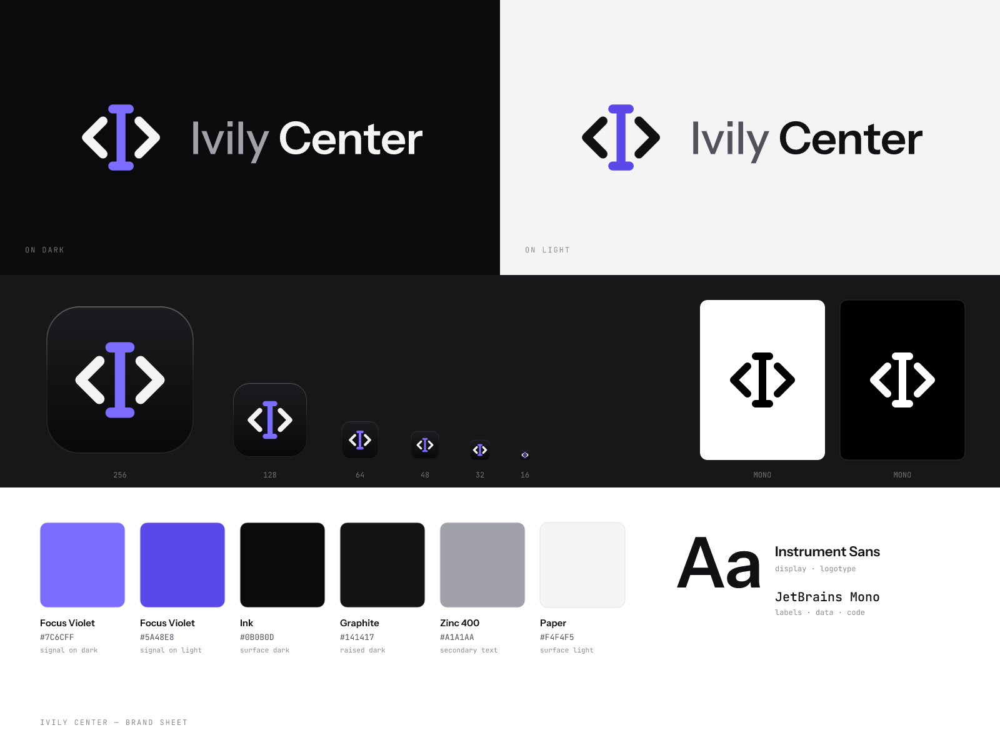

<p align="center">
  <picture>
    <source media="(prefers-color-scheme: dark)" srcset="logos/ivily-center-horizontal-on-dark.svg">
    
  </picture>
</p>

# Ivily Center — brand assets

Official logos, icons and visuals for Ivily Center, part of the Ivily ecosystem.
The full brand guide (rationale, construction, colour, typography, usage rules) lives in the Ivily design workspace; this folder contains everything needed to use the brand from this repository.

<p align="center"></p>

## Identity in one paragraph

**Symbol — the i-beam between brackets.** The symbol is a pair of code brackets framing an editor **I-beam** — the text cursor that every session in an IDE revolves around. Centre is literally where the cursor sits.

**Signal colour — Focus Violet:** `#7C6CFF` on dark, `#5A48E8` on light. Focus Violet marks *where attention is*: the caret, the active tab underline, the current line, the focused panel edge. Never use it for decoration or for status (errors stay red, success stays green).

## Contents

| Path | What | Use |
|---|---|---|
| `logos/ivily-center-horizontal-*.svg` | **Primary logo** (symbol + "Ivily Center") | READMEs, websites, documents |
| `logos/ivily-center-vertical-*.svg` | Stacked logo | Splash screens, square placements |
| `logos/ivily-center-logotype-*.svg` | Name only | Next to an existing symbol |
| `logos/ivily-center-symbol-*.svg` | Symbol only | Title bars, favicons, tight spaces |
| `logos/png/` | Transparent PNG renders | Where SVG is not accepted |
| `icons/ivily-center-app-icon.svg` | Application icon master (1024) | Source for every icon size |
| `icons/ivily-center-app-icon-small.svg` | Optical variant for 16–32 px | Small icon sizes |
| `icons/ivily-center-app-icon-light.svg` | Light container variant | Light marketing contexts |
| `icons/png/` | App icon PNG 16 → 1024 | Stores, websites, docs |
| `icons/ivily-center.ico` | Windows icon (16, 24, 32, 48, 64, 128, 256) | Installer, shortcuts |
| `icons/tauri/` | Drop-in set with `src-tauri/icons/` file names | Adopting the icon in the app |
| `banners/ivily-center-readme-banner-{dark,light}.svg` | README header, 1600 × 560 | This repository's README |
| `banners/ivily-center-social-preview.png` | 1280 × 640 | GitHub → Settings → Social preview |
| `illustrations/ivily-center-product-visual-*.{svg,png}` | Product visual — **illustration, not a screenshot** | Storytelling, docs |
| `patterns/ivily-center-pattern-tile-*.svg` | Seamless tile | Backgrounds at 4–8 % opacity |
| `ecosystem/` | Ivily parent mark, ecosystem lineup and diagram | "Part of Ivily" sections |
| `palette.json`, `tokens.css` | Colour and type tokens | Web pages, future UI work |

Colourway suffixes: `-on-dark`, `-on-light`, `-mono-white`, `-mono-black`.

## Using the logo in Markdown

```html
<picture>
  <source media="(prefers-color-scheme: dark)" srcset="assets/brand/logos/ivily-center-horizontal-on-dark.svg">
  
</picture>
```

## Adopting the new application icon

The application currently ships its existing icon (`src-tauri/icons/`) and its in-app logo is unchanged. Switching is a deliberate product decision. When ready:

```powershell
Copy-Item assets/brand/icons/tauri/* src-tauri/icons/ -Force
# or regenerate every platform size from the master:
npx tauri icon assets/brand/icons/ivily-center-app-icon.svg -o src-tauri/icons
```

Then rebuild and check the taskbar, installer and Start-menu icons at 100 % and 150 % scaling.

## Rules

- Keep clear space of ¼ of the symbol height around every logo. Minimum symbol size 16 px.
- Use the colourway that matches the background; never recolour, outline, add effects, rotate or stretch.
- Only Focus Violet may appear as a colour in Ivily Center brand materials.
- Product visuals are illustrations and must be labelled as such.

## Other files in this folder

- `icon.svg` — the original Center icon, kept for reference.

---

<sub>Generated from the Ivily design workspace. Typefaces in logos: Instrument Sans and JetBrains Mono (SIL Open Font License 1.1), converted to outlines.</sub>
